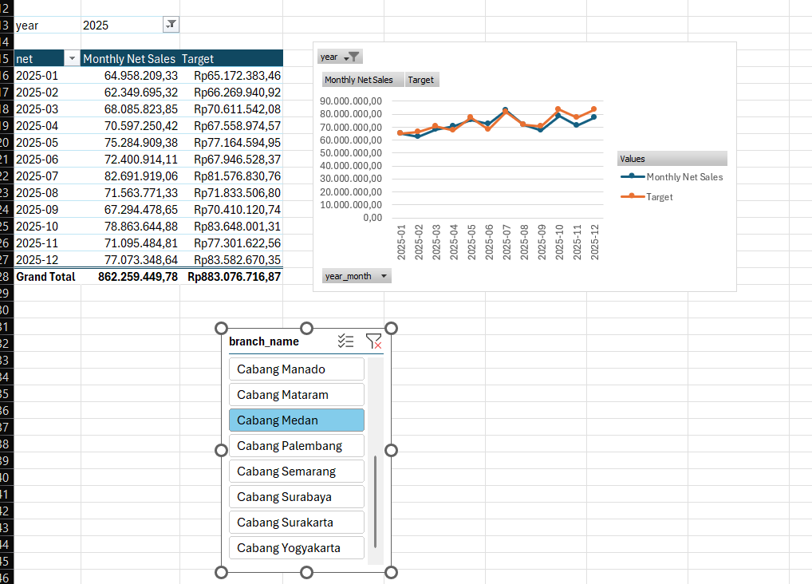
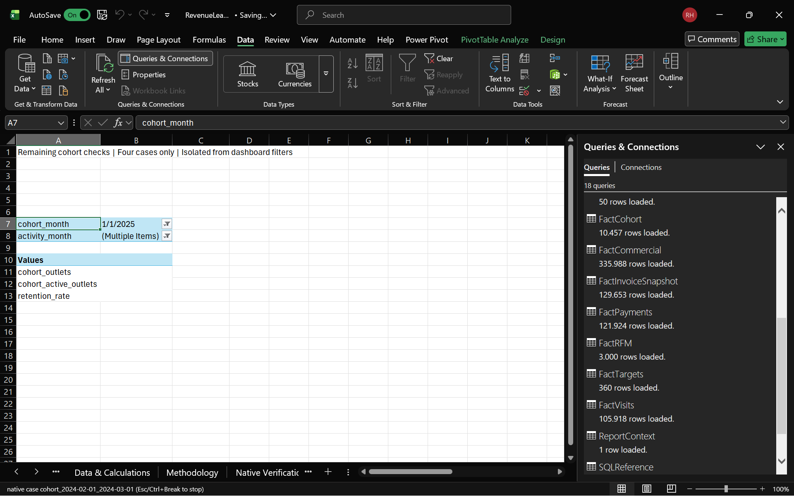

# Revenue Leakage & Sales Performance Analysis

A PostgreSQL and Excel case study for an Indonesian FMCG distributor. The project investigates sales performance, revenue leakage, returns and overdue receivables, then turns the findings into prioritized recommendations.

**All data are synthetic.** The dataset covers 2024–2025; results demonstrate analytical methods, not real-company performance or a validated business forecast.

## Key findings

Calendar 2025; receivables snapshot: 31 December 2025. Amounts in IDR.

| Finding | Result |
|---|---:|
| Net sales | 15.76 billion |
| Gross profit / margin | 3.85 billion / 24.43% |
| Merchandise returns | 210.28 million |
| Below-reference price exposure | 3.02 million, entirely in Medan |
| Overdue billed receivables | 3.24 billion |

Returns are the largest observed revenue deduction. A scenario preventing 5% of returns preserves **10.51 million in revenue**, with **2.55 million associated gross profit**, before costs. These are two views of one benefit; price exposure and collections are separate opportunities. See [recommendations](docs/recommendations.md) for evidence and assumptions.

## Dashboard

[Download the Excel workbook](excel/RevenueLeakage.xlsx). It includes Power Query, an embedded Data Model, DAX measures, PivotTables, charts and slicers.

These are development captures. Numeric results reconcile to SQL; final formatting and save/reopen acceptance were operator-reported. [Verification notes](docs/final_qa.md) explain the coverage.

## Try it

1. Restore the bundled PostgreSQL snapshot using the [setup guide](docs/setup.md).
2. Export the Excel inputs: `./sql/05_excel/02_export.ps1`.
3. Open the workbook, set `pFolder` to the exported CSV directory, and **Refresh All**. See [refresh and recovery](docs/refresh.md).

Requires Docker Desktop, PowerShell, and Excel desktop for Windows with Power Query and Data Model support. Node.js 20.16+ is used for optional validation. Run commands from the repository root. Existing `bintel` stays read-only.

## Project guide

| Document | What it covers |
|---|---|
| [Recommendations](docs/recommendations.md) | Priorities, SQL evidence and estimated impact |
| [Core analysis](docs/core_analysis.md) | Business questions and findings |
| [KPI dictionary](docs/kpi_dictionary.md) | Metric definitions and reporting rules |
| [Data dictionary](docs/data_dictionary.md) · [ERD](docs/erd.md) | Source schema and relationships |
| [Optimization report](docs/optimization_report.md) | Measured query improvements and plan evidence |
| [Setup](docs/setup.md) · [Refresh](docs/refresh.md) | Restore and workbook operation |
| [Verification](docs/final_qa.md) | Reproduction results and acceptance limits |

SQL is organized by setup, audit, KPIs, analysis, optimization and Excel export under `sql/`. Model definitions and validation utilities are under `excel/`.

## Methods and limitations

The project uses CTEs, window functions, historical SCD2 joins and query-plan comparisons. Rewrite-only warm-cache medians improved **3.30× for leakage**, **3.00× for visits** and **3.65× for cohort analysis** on this synthetic snapshot.

Revenue recognizes returns on their event dates. Discounts, price exposure and returns are not an additive recoverable-loss total; collecting receivables creates cash, not new revenue. Reference prices are not proven achievable prices, and return records do not establish invoice-settling credit notes. Limited history and synthetic behavior prevent causal or production ROI claims.
