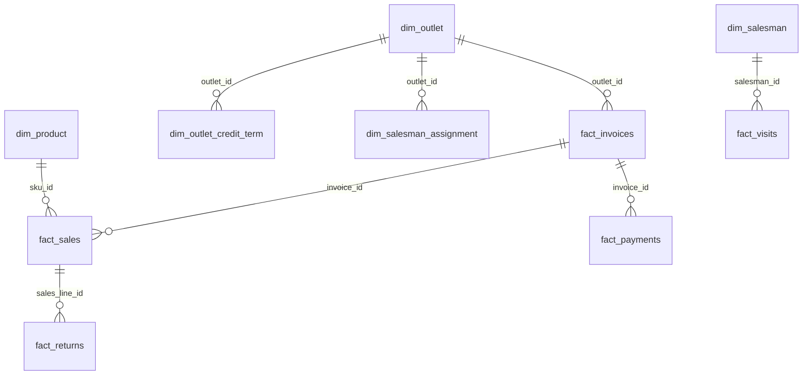

# Revenue Leakage & Sales Performance Analysis

A PostgreSQL and Excel portfolio case study for an Indonesian FMCG distributor: locate revenue deductions, explain sales performance, prioritize collections, and turn validated evidence into actions. The project uses SQL CTEs, window functions, point-in-time SCD2 joins, query-plan experiments, Power Query, an embedded Data Model, DAX and native PivotTables/charts/slicers. No Python pipeline, API, ML or Power BI is required.

**Synthetic data.** Every record is synthetic; there is no real-company performance claim. The snapshot covers 2024–2025 and the original generator is unavailable, so reproduction starts from the bundled database dump. Results demonstrate analytical methods, not production ROI, legal collectibility or causal effects. No business forecast is validated.

## Findings and decisions

Default operating period: **1 January–31 December 2025**; AR/RFM snapshot: **31 December 2025**. Amounts are nominal IDR; ratios are computed from summed components. The [KPI dictionary](docs/kpi_dictionary.md) is the definition contract.

| Evidence | Observed result | Decision / interpretation |
|---|---:|---|
| Event-period net sales | 15,762,528,589.51 | Above national monetary target of 15,742,179,409.15; national totals hide branch gaps. |
| Gross profit / margin | 3,851,071,463.51 / 24.43% | Gross profit, before operating costs. |
| Merchandise returns | 210,279,535.21 | Largest observed revenue deduction; gross-profit reversal is 50,939,314.21, already in profit. |
| Recorded discounts | 31,877,245.06 | Not automatically improper or recoverable. |
| Below-reference price exposure | 3,023,132.22 | Entirely Medan; reference price is not proven achievable revenue. |
| Invalid attached-promo discount / salesman mismatch sales | 0 / 0 | Supplied flags support no monetary recovery claim for either. |
| Bandung target gap / achievement | −32,431,359.96 / 96.67% | No target volume/price/discount baseline exists to establish causes. |
| Outstanding / overdue billed AR | 3,396,761,237.52 / 3,239,849,366.28 | Cash exposure; returns do not establish invoice-settling credit notes. |
| Credit-only trailing-90-day DSO | 87.26 days | Collection-velocity estimate, not average delinquency. |

See [core analysis](docs/core_analysis.md), [executable recommendation evidence](sql/03_analysis/04_recommendation_evidence.sql), and [recommendations](docs/recommendations.md). The return-prevention scenario assumes 5% avoidable returns: annual revenue preserved **10,513,976.76**, with associated gross profit **2,546,965.71** before costs. These are two views of the same benefit. Medan price and AR cash scenarios remain separate; no additive recoverable-loss total is claimed.

## Deliverables and navigation

| Artifact | Purpose |
|---|---|
| [RevenueLeakage.xlsx](excel/RevenueLeakage.xlsx) | Macro-free workbook with embedded Data Model, Power Query, measures and interactive dashboards. |
| [Source ERD](docs/erd.md) / [data dictionary](docs/data_dictionary.md) | All 13 source tables, exact column types/nullability and 31 foreign keys. |
| [Data audit](docs/data_audit.md) / [KPI dictionary](docs/kpi_dictionary.md) | Grain, date coverage, controls and reporting semantics. |
| [Core analysis](docs/core_analysis.md) / [recommendations](docs/recommendations.md) | Business diagnostics and explicitly assumed interventions. |
| [Optimization report](docs/optimization_report.md) / [plan excerpts](docs/optimization/plan-excerpts.txt) | Before/after timings, buffer/plan evidence and tradeoffs. |
| [Excel model guide](docs/excel_model.md) / [refresh guide](docs/refresh.md) | CSV contract, model relationships, setup and safe refresh/recovery. |
| [Final QA](docs/final_qa.md) / [Phase 4 acceptance](docs/excel/phase4-handoff.md) | Reproduction results and exact native-evidence attribution/limits. |
| [SQL catalog](docs/sql_catalog.md) | Purpose, sources, assumptions and execution dependencies for each SQL file. |

Source tables total **706,939 rows**, including 329,263 sales lines, 129,653 invoices, 6,725 returns, 121,924 payments and 105,918 visits. Sales lines link to invoices; payments link to invoices; returns link to sales lines. Historical outlet terms and assignments require dated inclusive joins, rather than current-flag filtering. Aggregate child facts before joining to avoid multiplying money. The [full ERD](docs/erd.md) preserves role-specific relationships; the main fact chain is:



## Dashboard evidence

The images below are actual Phase 4 captures. They demonstrate native pivot/chart response and refresh state; they predate the final operator-reported formatting repairs and are not claimed to be newly captured final-layout screenshots. The [acceptance record](docs/excel/phase4-handoff.md) distinguishes numeric evidence from operator attestation.


Medan filtered 2025 revenue is **862,259,449.78**, reconciled to SQL. Clear the branch slicer to restore the national view.


## Reproduce from the bundled snapshot

Requirements: Windows PowerShell, Docker Desktop with Linux containers, PostgreSQL **16** utilities in the container, and Node.js **20.16+** (tested with 20.16.0) for CSV/capture checks. Excel desktop for Windows with Power Query and Data Model/Power Pivot is needed to interact with or refresh the workbook. Use a supported Excel edition with those features enabled. Commands run from the repository root. Never put passwords in tracked files.

The existing local container/user/source are `bintel-pg` / `bintel` / `bintel`. Source analysis is SELECT-only apart from session-local temporary objects. Restore/optimization work belongs in isolated databases. Container-local CLI authentication uses your existing PostgreSQL configuration.

On a fresh machine only, create a disposable local container (skip if `bintel-pg` already exists):

```powershell
docker run --name bintel-pg -d -e POSTGRES_USER=bintel -e POSTGRES_DB=bintel -e POSTGRES_HOST_AUTH_METHOD=trust postgres:16
docker exec bintel-pg pg_isready -U bintel -d bintel
```

Wait for accepting connections. No host port is published; trust authentication is for this disposable local example, not deployment. Restore the synthetic source into the empty `bintel` database:

```powershell
docker cp data/analytics.dump bintel-pg:/tmp/leakage-analytics.dump
docker exec bintel-pg pg_restore -U bintel -d bintel --no-owner --no-privileges --exit-on-error /tmp/leakage-analytics.dump
if ($LASTEXITCODE -ne 0) { throw 'Source restore failed' }
```

Run that restore only against an empty database. Never restore over the existing source. The dump includes schema and rows; do not execute the standalone [DDL](sql/00_setup/analytics_schema.sql) before restoring it. The DDL alone supplies no data.

With the source available, run the final reproducibility check:

```powershell
./sql/06_qa/01_reproduce.ps1
if ($LASTEXITCODE -ne 0) { throw 'QA failed' }
```

The runner creates **new** `leakage_qa_phase6` from `template0`, restores the bundled dump, compares source/copy audits and both reference-validation suites across five date scenarios, executes recommendation evidence, and exports the Excel input queries on the copy. Every reproduced CSV SHA-256 must match the accepted Excel-source manifest. It refuses an existing destination and never drops a database. For another run, pass a new name, for example `-Database leakage_qa_run2`. Logs are in `docs/qa/`; scratch exports are in local `data/phase6-qa/`. The source and accepted workbook are not changed. Node checks in [final QA](docs/final_qa.md) recompare stored native Excel captures without rerunning macros.

`data/excel/*.csv` are generated local files excluded from Git; `data/excel/manifest.json` is tracked as the accepted hash baseline. On a new clone, generate it first using `./sql/05_excel/02_export.ps1`; then run `node excel/verify_exports.mjs` before the final QA runner. This creates the manifest used for comparison. On the existing accepted workspace, retain the accepted manifest instead of regenerating it before comparison.

To read another supported period, copy SQL and invoke the reference report directly:

```powershell
docker cp sql/. bintel-pg:/tmp/leakage-sql
docker exec bintel-pg psql -X -q -U bintel -d bintel -v ON_ERROR_STOP=1 -v period_start=2024-01-01 -v period_end=2024-12-31 -v as_of_date=2024-12-31 -f /tmp/leakage-sql/02_kpi/01_reference_metrics.sql
```

Require `2024-01-01 <= period_start <= period_end <= as_of_date <= 2025-12-31`. Targets require complete calendar months. Undefined ratios remain NULL/BLANK. AR and RFM are snapshots; never sum them across dates.

## Optional analytical and performance reproduction

The full SQL regression scripts are `sql/02_kpi/03_verify_phase1.ps1` and `sql/03_analysis/03_verify_phase2.ps1`; their default comparison database is `leakage_lab`. The final QA runner already exercises the valid-date suites against its newly restored destination. For optimization, create a separate **new** `leakage_lab` from the bundled dump with `createdb -T template0` and `pg_restore --no-owner --no-privileges --exit-on-error`, then run:

```powershell
./sql/04_optimization/03_run_benchmarks.ps1
```

This is optional for final numeric reconciliation. It is guarded to `leakage_lab`, measures 54 plans and cleans up only its two experimental indexes. Existing results: rewrite-only medians improve **3.30× leakage**, **3.00× visits**, **3.65× cohort** under controlled warm-cache settings. The composite call index helps visits but can slow cohort; the promo-flag index has no observed plan benefit. These are one-machine, synthetic-data measurements, not production latency or financial savings. See the report for ranges, equality checks, settings and limitations.

## Excel setup, refresh and limitations

Follow the [refresh guide](docs/refresh.md) and [model guide](docs/excel_model.md). Export default-period CSVs, set workbook `pFolder` to their absolute directory, refresh and verify the SQL-reference cards. Preserve the delivered workbook's manual formatting. Do not run Build/Finish or the exhaustive native Verify macro merely for validation. The delivered `.xlsx` contains no VBA; separate `.bas` files are optional setup helpers.

Revenue uses sales-date billing less return-date events, not lifetime linked-return columns. The bridge is reference sales + upside − price shortfall − discounts − event returns = net sales. Invalid-promo discounts are already inside discounts; returns' margin reversal already affects profit. AR has no demonstrated return credit-note settlement, and reference prices are not proven realizable. Same-day visit conversion is association; RFM/cohort bands are analytic conventions, and later cohort ages have different eligible populations. No target volume/price/discount attribution, loss estimate from salesman mismatch, or causal intervention effect is supported. Final native capture coverage and operator-only acceptance are disclosed in the QA and Phase 4 records.
