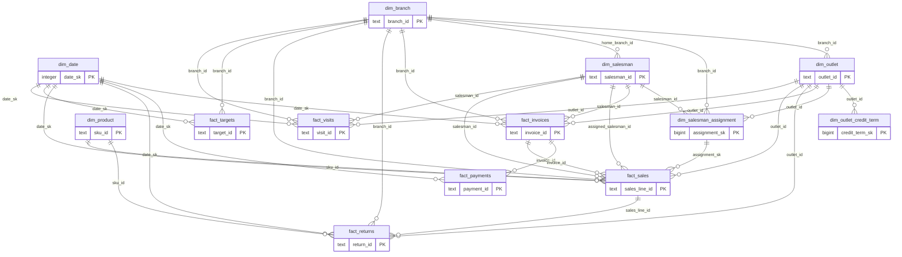

# Source schema ERD

All 13 source tables and 31 declared foreign keys from [schema DDL](../sql/00_setup/analytics_schema.sql). Parent-to-child cardinality is one to zero/many; nullable foreign keys do not require a parent for every child. Distinct role keys are retained. This describes source constraints, not the Excel relationship graph.

Historical joins: invoice date within outlet credit-term bounds; sale date within assignment bounds, both inclusive. SCD2 interval uniqueness is enforced by validation in addition to the declared keys. Aggregate payments by invoice and returns by sales line before parent joins to prevent fanout. See [data dictionary](data_dictionary.md) for all column types and [KPI contract](kpi_dictionary.md) for reporting dates.
